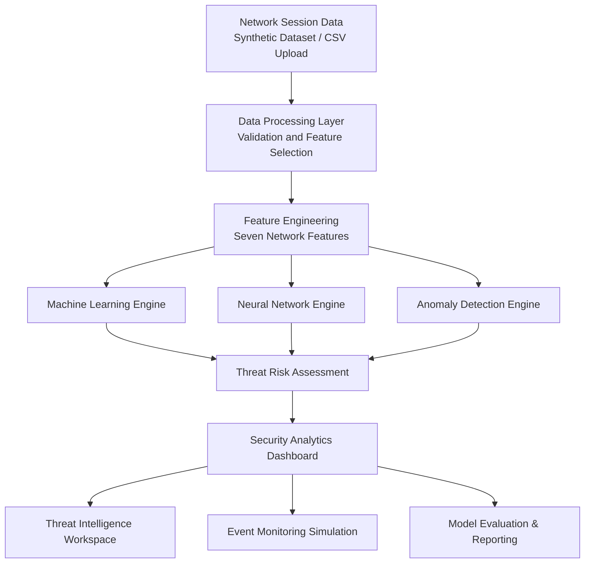
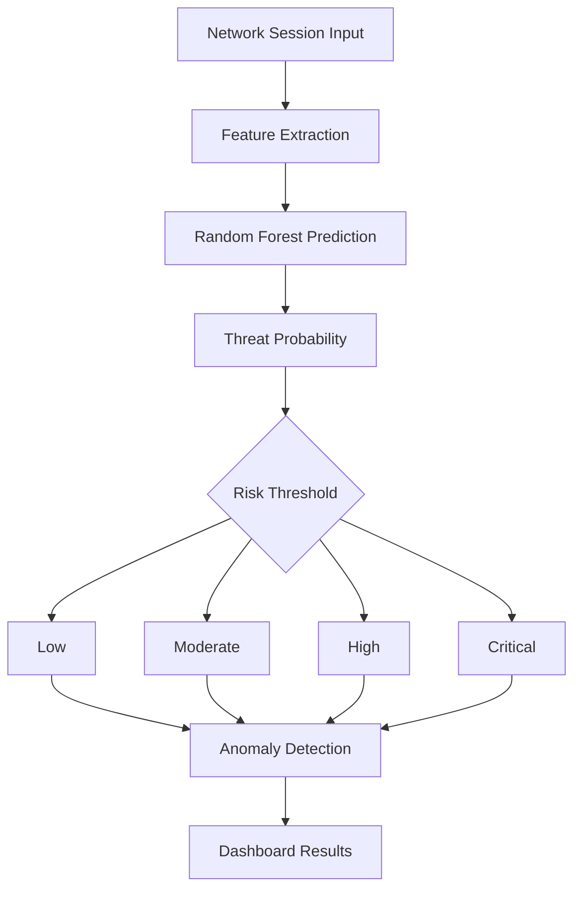
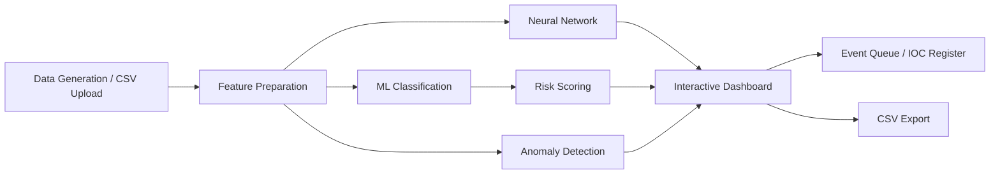

# SentinelX AI
### Cybersecurity Intelligence & Threat Detection Platform

<p align="center">
  
</p>

<p align="center">
  <strong>An Intelligent Security Analytics & Threat Detection System</strong>
</p>


<p align="center">
  <strong>Machine Learning | Deep Learning | Threat Detection | Anomaly Analytics | Security Intelligence</strong>
</p>

---

## 1. Project Overview

**SentinelX AI** is an interactive cybersecurity intelligence and threat detection platform developed to demonstrate how machine learning, neural-network modelling, anomaly detection and security analytics can support the identification and assessment of suspicious network activities.

The platform brings multiple security analytics capabilities into a unified Streamlit dashboard. It analyses network-session characteristics, estimates threat probabilities, identifies unusual behavioural patterns, simulates security event monitoring and provides an interface for managing indicators of compromise (IOCs).

Designed around a modular security analytics workflow, SentinelX AI combines supervised classification, unsupervised anomaly detection, data exploration and model evaluation to demonstrate an end-to-end threat intelligence workflow.

The application is developed using Python, Streamlit, Scikit-learn, Pandas, NumPy and Plotly.

### Project Objectives

- Develop a machine-learning-based cybersecurity threat classification system.
- Apply neural-network modelling to network-session threat assessment.
- Identify unusual network behaviour using unsupervised anomaly detection.
- Generate risk probabilities and classify events into risk categories.
- Demonstrate simulated security event monitoring and alert triage.
- Provide an interactive workspace for indicator-of-compromise management.
- Visualize network telemetry, threat distributions and model performance.
- Deliver an accessible, interactive cybersecurity analytics dashboard.

---

## 2. Core Capabilities

| Capability | Implementation |
|---|---|
| Threat Classification | Random Forest Classifier |
| Neural-Network Modelling | Multilayer Perceptron (MLP) |
| Anomaly Detection | Isolation Forest |
| Risk Assessment | Probability-based threat scoring |
| Security Monitoring | Simulated event generation and monitoring |
| Threat Intelligence | Manual IOC registration and triage |
| Data Analytics | Pandas and NumPy |
| Model Evaluation | Accuracy, Precision, Recall and F1-score |
| Data Visualization | Plotly |
| Interactive Dashboard | Streamlit |
| Deployment | Render |

### Key Features

**1. Intelligent Threat Detection**

- Analyse network-session characteristics.
- Predict potential threat classifications.
- Calculate threat probabilities.
- Categorize events into Low, Moderate, High and Critical risk levels.
- Display anomaly indicators for additional investigation.

**2. Neural-Network-Based Classification**

- Implement a Multilayer Perceptron classifier.
- Apply feature scaling through StandardScaler.
- Compare neural-network predictions against Random Forest.
- Evaluate both models using classification metrics.

**3. Anomaly Detection**

- Apply Isolation Forest for unsupervised anomaly identification.
- Detect observations that differ from expected data patterns.
- Flag unusual sessions for analyst review.
- Display anomaly indicators alongside threat probabilities.

**4. Simulated Security Monitoring**

- Generate batches of synthetic network events.
- Perform automated threat scoring on generated events.
- Maintain a session-based event queue.
- Identify high-risk events and anomalies.
- Export event monitoring results.

**5. Threat Intelligence Management**

- Maintain an indicator-of-compromise register.
- Support IPv4 addresses, domains, URLs and file hashes.
- Record severity levels and contextual information.
- Track indicator review statuses.
- Export the IOC register.

**6. Security Analytics and Visualization**

- Explore network-session datasets.
- Visualize feature distributions.
- Compare network characteristics.
- Inspect threat classifications.
- Download processed datasets and analysis results.

---

## 3. System Architecture

SentinelX AI follows a modular analytics architecture that connects data generation, feature processing, machine-learning models, anomaly detection and dashboard presentation.

### High-Level Architecture



### Architecture Components

| Layer | Responsibility | Technologies |
|---|---|---|
| Data Layer | Generate and receive network-session records | NumPy, Pandas |
| Processing Layer | Select and prepare input features | Pandas |
| Classification Layer | Predict potential threats | Random Forest |
| Neural-Network Layer | Perform neural classification | Scikit-learn MLP |
| Anomaly Layer | Identify unusual observations | Isolation Forest |
| Risk Assessment Layer | Calculate probabilities and risk categories | Python, NumPy |
| Presentation Layer | Display results and interactive controls | Streamlit |
| Visualization Layer | Generate analytical charts | Plotly |
| Deployment Layer | Host the dashboard publicly | Render |

### Processing Architecture

The application follows these processing stages:

1. **Data Input:** Generate synthetic network-session data or upload compatible CSV telemetry.
2. **Feature Selection:** Extract the seven required network characteristics.
3. **Classification:** Pass prepared features through the Random Forest and MLP models.
4. **Anomaly Detection:** Evaluate observations using Isolation Forest.
5. **Risk Assessment:** Calculate threat probabilities and assign risk categories.
6. **Visualization:** Present predictions, risk distributions and anomalies.
7. **Investigation:** Allow users to review results, manage IOCs and export reports.

---

## 4. Dataset & Feature Engineering

The current implementation uses a generated network-session dataset designed for demonstrating cybersecurity classification and anomaly analytics.

The dataset contains seven input features and one target variable.

### Input Features

| Feature | Description |
|---|---|
| `session_duration` | Duration of a network session |
| `packet_size` | Network packet size |
| `failed_logins` | Number of failed login attempts |
| `connection_rate` | Connection activity rate |
| `port_risk` | Simulated port-risk indicator |
| `geo_risk_score` | Simulated geographical risk score |
| `night_activity` | Indicator of activity during night hours |

**Target Variable:** `threat_label`

- `0` – Benign session
- `1` – Threat session

### Dataset Generation

The application generates synthetic observations using NumPy probability distributions.

The generated features include:

- Gamma-distributed session duration and connection activity.
- Normally distributed packet sizes.
- Poisson-distributed failed login counts.
- Categorical port-risk levels.
- Beta-distributed geographical risk scores.
- Binary night-activity indicators.

A composite score is calculated from these characteristics. A percentile-based threshold is then used to generate the binary threat label.

This provides a controlled dataset for demonstrating classification, probability scoring and anomaly detection.

### Feature Processing

The model uses the following seven features:

```python
FEATURES = [
    "session_duration",
    "packet_size",
    "failed_logins",
    "connection_rate",
    "port_risk",
    "geo_risk_score",
    "night_activity"
]
```

The neural-network pipeline applies StandardScaler before classification. The Random Forest and Isolation Forest operate on the selected feature values.

---

## 5. Machine Learning & Deep Learning Models

SentinelX AI incorporates three machine-learning algorithms to demonstrate complementary approaches to cybersecurity analytics.

### 5.1 Random Forest Classifier

**Purpose:** Supervised threat classification.

Random Forest combines multiple decision trees to generate predictions based on network-session characteristics.

Implementation:

- 180 estimators.
- Maximum tree depth of 10.
- Balanced class weights.
- Fixed random state for reproducibility.

```python
RandomForestClassifier(
    n_estimators=180,
    max_depth=10,
    class_weight="balanced",
    random_state=42
)
```

**Applications:**
- Binary threat classification.
- Threat probability estimation.
- Risk categorization.
- Feature importance analysis.

### 5.2 Multilayer Perceptron (MLP)

**Purpose:** Neural-network-based threat classification.

The MLP model learns relationships between network-session features through multiple hidden layers.

Architecture:

```text
Input Layer
    |
    | 7 Network Features
    |
StandardScaler
    |
Hidden Layer 1
    | 64 Neurons
    |
Hidden Layer 2
    | 32 Neurons
    |
Output Layer
    |
Binary Threat Classification
```

Implementation:

```python
MLPClassifier(
    hidden_layer_sizes=(64, 32),
    max_iter=350,
    early_stopping=True,
    random_state=42
)
```

The MLP model is implemented using Scikit-learn and compared with the Random Forest classifier.

### 5.3 Isolation Forest

**Purpose:** Unsupervised anomaly detection.

Isolation Forest identifies observations that exhibit unusual characteristics compared with the overall dataset.

Implementation:

```python
IsolationForest(
    contamination=0.12,
    n_estimators=160,
    random_state=42
)
```

The model uses its prediction output to flag unusual observations:

- `1` – Normal observation.
- `-1` – Anomaly.

The application converts these predictions into an anomaly indicator for dashboard presentation.

### Model Comparison

| Model | Learning Approach | Primary Function |
|---|---|---|
| Random Forest | Supervised Learning | Threat Classification |
| MLP | Neural-Network Classification | Threat Classification |
| Isolation Forest | Unsupervised Learning | Anomaly Detection |

---

## 6. Threat Risk Assessment

The threat detection workspace uses the Random Forest model to estimate the probability of a threat.

The predicted probability is used to assign one of four risk categories.

### Risk Classification

| Probability | Risk Category |
|---|---|
| Below 25% | Low |
| 25% to below 50% | Moderate |
| 50% to below 75% | High |
| 75% and above | Critical |

The probability thresholds provide a simple demonstration of risk-based classification.

### Risk Assessment Workflow



The anomaly indicator is presented separately from the classification probability, allowing users to inspect unusual observations alongside model-assessed risk.

---

## 7. Dashboard Workspaces

The application provides seven interactive workspaces designed around different cybersecurity analytics tasks.

### 7.1 Overview

The central security analytics dashboard.

Features:
- Total network events analysed.
- Number of threat-labelled observations.
- High and critical model-assessed events.
- Anomaly counts.
- Threat-risk distribution.
- Risk probability histogram.
- High-risk event preview.

### 7.2 Threat Detection

An interactive workspace for evaluating network sessions.

Features:
- Upload compatible network-session CSV files.
- Validate required input columns.
- Generate threat probabilities.
- Assign risk categories.
- Display anomaly indicators.
- Perform manual session assessment.
- Download scored event results.

### 7.3 Live Monitoring

A simulated event-monitoring environment.

Features:
- Generate configurable batches of network events.
- Process generated sessions through the detection pipeline.
- Populate a session-based event queue.
- Display high-risk event counts.
- Display anomaly counts.
- Export monitoring results.
- Clear the event queue.

**Implementation note:** This workspace demonstrates simulated monitoring rather than continuous ingestion from live network traffic.

### 7.4 Threat Intelligence

A manual indicator-of-compromise management workspace.

Supported indicator types:
- IPv4 addresses.
- Domains.
- URLs.
- File hashes.

Features:
- Register new indicators.
- Assign severity levels.
- Add contextual analyst notes.
- Maintain review statuses.
- Export the IOC register.

**Implementation note:** The IOC register is manually maintained and does not retrieve intelligence from external threat feeds.

### 7.5 Model Lab

A model-performance and explainability workspace.

Features:
- Compare Random Forest and MLP predictions.
- Calculate Accuracy.
- Calculate Precision.
- Calculate Recall.
- Calculate F1-score.
- Display confusion matrices.
- Visualize Random Forest feature importance.

### 7.6 Data Explorer

A network telemetry exploration workspace.

Features:
- Inspect generated network-session records.
- Select dataset columns.
- Visualize feature distributions.
- Generate feature-comparison scatter plots.
- Explore threat-labelled observations.
- Download the demonstration dataset.

### 7.7 About & Governance

Provides information about the application's implementation scope, technologies, responsible use and limitations.

---

## 8. Model Evaluation

The application evaluates its supervised classification models using a held-out test dataset.

The dataset is divided using a stratified train-test split:

- Training data: 75%.
- Testing data: 25%.

### Evaluation Metrics

| Metric | Purpose |
|---|---|
| Accuracy | Overall proportion of correct predictions |
| Precision | Proportion of predicted threats that are actual labelled threats |
| Recall | Proportion of actual labelled threats correctly identified |
| F1-score | Harmonic mean of precision and recall |
| Confusion Matrix | Distribution of correct and incorrect predictions |

### Model Evaluation Process

```text
Generated Dataset
       |
       v
Feature Selection
       |
       v
Stratified Train-Test Split
       |
       +----------------------+
       |                      |
       v                      v
 Random Forest             MLP Model
       |                      |
       v                      v
 Predictions               Predictions
       |                      |
       +----------+-----------+
                  |
                  v
          Evaluation Metrics
                  |
                  v
         Confusion Matrices
                  |
                  v
         Model Comparison
```

**Evaluation disclaimer:** Model performance is measured on synthetic data generated using the application's own label-generation logic. These metrics demonstrate implementation and evaluation workflows; they are not validated indicators of real-world cybersecurity detection performance.

---

## 9. Technology Stack

### Programming Language
- Python

### Machine Learning & Deep Learning
- Scikit-learn
- Random Forest
- Multilayer Perceptron
- Isolation Forest

### Data Processing
- Pandas
- NumPy

### Data Visualization
- Plotly

### Dashboard Development
- Streamlit

### Development Environment
- Visual Studio Code
- Python Virtual Environment
- Git
- GitHub Desktop

### Cloud Deployment
- Render

---

## 10. System Data Flow

The platform processes information through the following logical workflow:



The application also supports independent workflows for model evaluation, manual session assessment and dataset exploration.

---

## 11. Project Structure

```text
SentinelX-AI/
│
├── .streamlit/
│   └── config.toml
│
├── assets/
│   └── sentinelx_logo.png
│
├── app.py
├── requirements.txt
├── render.yaml
├── README.md
├── LICENSE
└── .gitignore
```

### File Responsibilities

| File | Purpose |
|---|---|
| `app.py` | Main Streamlit application, model training, analytics and dashboard workspaces |
| `requirements.txt` | Python dependency definitions |
| `render.yaml` | Render deployment configuration |
| `README.md` | Project documentation |
| `LICENSE` | MIT License |
| `.gitignore` | Excludes virtual environments, secrets and temporary files |
| `.streamlit/config.toml` | Dashboard theme and Streamlit server configuration |
| `assets/sentinelx_logo.png` | Application logo |

---

## 12. Installation & Local Setup

Follow these instructions to run SentinelX AI locally.

### Prerequisites

- Python 3.10 or later.
- Visual Studio Code.
- Git.
- Internet connection for installing dependencies.

### Step 1: Clone the Repository

```bash
git clone https://github.com/YOUR_USERNAME/SentinelX-AI.git
```

### Step 2: Navigate to the Project

```bash
cd SentinelX-AI
```

### Step 3: Create a Virtual Environment

```bash
python -m venv venv
```

### Step 4: Activate the Environment

**Windows PowerShell:**

```powershell
.\venv\Scripts\Activate.ps1
```

**macOS / Linux:**

```bash
source venv/bin/activate
```

### Step 5: Install Dependencies

```bash
python -m pip install --upgrade pip
pip install -r requirements.txt
```

### Step 6: Run the Application

```bash
streamlit run app.py
```

### Step 7: Open the Dashboard

Visit:

```text
http://localhost:8501
```

The SentinelX AI dashboard will launch in your browser.

---

## 13. Deployment on Render

SentinelX AI is configured for deployment as a Python-based Streamlit web service on Render.

### Deployment Configuration

| Setting | Value |
|---|---|
| Service Type | Web Service |
| Runtime | Python |
| Branch | main |
| Build Command | `pip install -r requirements.txt` |
| Start Command | `streamlit run app.py --server.port $PORT --server.address 0.0.0.0` |
| Health Check | `/` |

### Deployment Steps

1. Push the SentinelX AI project to GitHub.
2. Sign in to Render.
3. Create a new Web Service or use the included Blueprint configuration.
4. Connect the GitHub repository.
5. Configure the build and start commands.
6. Deploy the application.
7. Wait for the service to become live.
8. Open the generated public URL.

### Public Dashboard URL

After deployment, add the following environment variable in Render:

```text
https://sentinelx-ai-ai-powered-cybersecurity.onrender.com/
```

The application reads this variable to display the **Open Live Dashboard** link in the footer.

---

## 14. Security, Privacy & Responsible Use

SentinelX AI is developed as an educational cybersecurity analytics demonstration.

Important considerations:

- The included network-session dataset is synthetic.
- The event monitoring functionality generates simulated events.
- The threat intelligence workspace is manually maintained.
- The application does not connect to real network sensors.
- The application does not execute automated blocking or remediation.
- Model predictions should not be treated as definitive security decisions.
- Model metrics are not validated against real-world attack datasets.
- Uploaded telemetry should not contain confidential or sensitive production information when using a public deployment.

The project demonstrates analytical concepts and implementation workflows rather than providing production-grade security protection.

---

## 15. Current Implementation & Future Enhancements

### Implemented

- [x] Synthetic network-session data generation.
- [x] Seven-feature threat classification pipeline.
- [x] Random Forest classifier.
- [x] MLP neural-network classifier.
- [x] Isolation Forest anomaly detection.
- [x] Probability-based threat risk categorization.
- [x] CSV upload and scored event export.
- [x] Manual network-session assessment.
- [x] Simulated security event monitoring.
- [x] Session-based event queue.
- [x] Manual IOC management.
- [x] Model evaluation and confusion matrices.
- [x] Feature importance visualization.
- [x] Interactive Streamlit dashboard.
- [x] Custom branding and dashboard theme.
- [x] GitHub repository configuration.
- [x] Render deployment configuration.

### Future Enhancements

- [ ] Integrate validated real-world cybersecurity datasets.
- [ ] Connect live network traffic monitoring sources.
- [ ] Implement real-time streaming data ingestion.
- [ ] Integrate external threat intelligence APIs.
- [ ] Introduce automated IOC enrichment.
- [ ] Develop advanced deep-learning architectures using PyTorch or TensorFlow.
- [ ] Implement sequence-based network behaviour analysis.
- [ ] Introduce model explainability using SHAP.
- [ ] Add user authentication and role-based access control.
- [ ] Implement persistent database storage.
- [ ] Introduce model drift monitoring.
- [ ] Develop automated alert notification mechanisms.
- [ ] Implement secure audit logging and incident investigation workflows.

---

## 16. Applications & Use Cases

The platform demonstrates concepts relevant to:

- Network security analytics.
- Cybersecurity threat classification.
- Suspicious activity assessment.
- Anomaly detection.
- Security event monitoring.
- Threat intelligence management.
- Machine-learning-based risk assessment.
- Security analytics visualization.
- AI-assisted cybersecurity research.

These are demonstration use cases, not claims of operational deployment.

---

## 17. GitHub Repository

**Repository:** `SentinelX-AI`

**Suggested Topics:**

`cybersecurity` · `machine-learning` · `threat-detection` · `anomaly-detection` · `network-security` · `deep-learning` · `python` · `streamlit` · `scikit-learn` · `security-analytics`

---

## 18. Author

**Mohamed Riyaz S.**  
Integrated M.Tech – Computer Science and Engineering (Business Analytics)  
Vellore Institute of Technology (VIT), Chennai

**Project:** SentinelX AI – Cybersecurity Intelligence & Threat Detection Platform

---

## 19. License

This project is distributed under the MIT License.

See the [LICENSE](LICENSE) file for details.

---

<p align="center">
  <strong>SentinelX AI</strong>
  <br/>
  Intelligent Threat Detection. Data-Driven Security Intelligence.
  <br/><br/>
  Developed by <strong>Mohamed Riyaz S.</strong>
</p>
